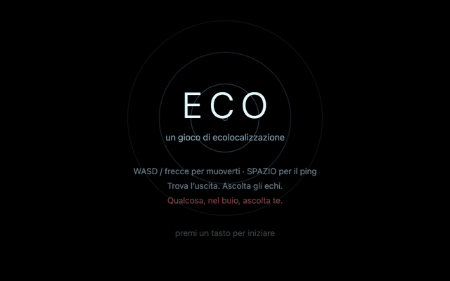

# ECO

A tiny browser game about echolocation, written in vanilla JavaScript — no
dependencies, no build step.

**[Play it in your browser](https://fede-berga.github.io/eco/)**



You are a small creature lost in a pitch-black cave. Press **SPACE** to emit a
ping: the sound wave expands outward and briefly lights up the walls it
touches. When a wave crosses the exit you hear a chime — panned toward it,
louder the closer you are. Navigate by memory and by ear.

From level 2 onward something else lives in the cave. It is blind too, but it
hears your pings through the rock — and it comes looking. Pings reveal it only as a
snapshot of where it *was*.

## Run

Serve the folder with any static server and open it in a browser:

```
python3 -m http.server 8123
```

Then visit http://localhost:8123.

## Controls

| Key | Action |
| --- | --- |
| WASD / arrows | move |
| SPACE | ping |
| R twice | regenerate the current level |

## How it works

- **Cave generation** — cellular automata smoothed over random noise; only the
  largest connected region is kept. Start and exit are placed far apart with a
  double BFS (the farthest cell from an arbitrary one, then the farthest cell
  from that), a cheap approximation of the cave's graph diameter.
- **Ping** — 540 rays are raycast on the grid (DDA) when the ping is emitted;
  each hit is revealed only when the expanding wavefront actually reaches it,
  so the ring visually gets absorbed where it meets rock.
- **Predator** — BFS pathfinding on the grid. It wanders when idle and hunts
  the origin of the last sound it heard: your pings, or your footsteps at
  close range. Its proximity is telegraphed by your own heartbeat.
- **Audio** — everything is synthesized live with WebAudio oscillators; there
  are no sound files.

## Limitations

- Keyboard only: there are no mouse or touch controls, so phones and tablets
  without a keyboard can't play it.
- Sound is part of the game: the panned exit chime is your main clue to where
  the exit is, so play with audio on.
- The in-game text is in Italian.

## License

[MIT](LICENSE)
